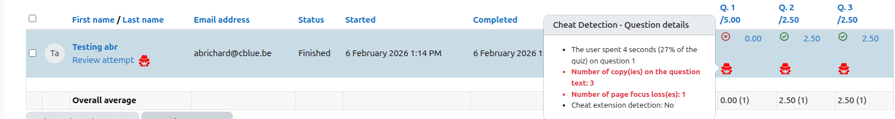
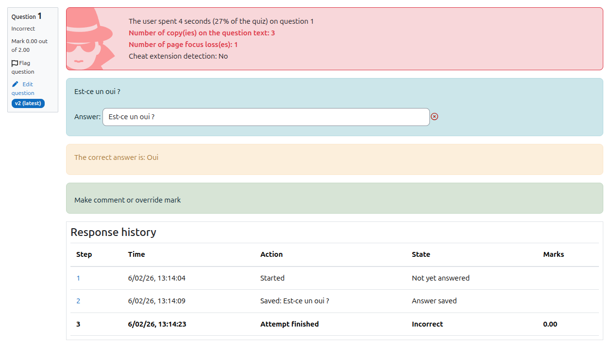

# Guide enseignant

## Activation

1. Créer ou modifier un quiz.
2. Sélectionner "Une question par page".
3. Enregistrer.

La surveillance est automatiquement activée.

Cette même surveillance fonctionne aussi lorsque le quiz est embarqué dans
un format de cours qui charge la page de tentative à l'intérieur d'une
iframe (par exemple `boostcamp_episode`). Aucune configuration
supplémentaire n'est requise de votre part.

---

## Consultation des données

Lors de la relecture d’une tentative, les enseignants peuvent consulter :

- Temps passé par question
- Pourcentage du temps total
- Nombre de copies
- Nombre de pertes de focus
- Détection d’extensions
- Résumé des événements suspects

---

## Interprétation

Un **nombre élevé de pertes de focus** est l'indicateur comportemental le
plus parlant — il reflète typiquement un changement d'onglet ou
d'application pendant la tentative. Chaque événement de perte de focus
enregistré par le plugin est qualifié en interne par un niveau :

- **Élevé (high)** — l'onglet du navigateur a été masqué (changement
  d'onglet, fenêtre minimisée).
- **Moyen (medium)** — la fenêtre du navigateur a perdu le focus au niveau
  du système (alt-tab, clic sur une autre application).

Ces niveaux sont stockés avec les événements bruts et pourront être
exposés dans de futures évolutions des rapports ; le rapport actuel
affiche le compteur agrégé.

Les **tentatives de copie** correspondent à une sélection de texte suivie
de Ctrl/Cmd+C à l'intérieur de l'énoncé d'une question. Elles ne capturent
pas le contenu saisi dans la zone de réponse.

Ces indicateurs doivent être interprétés avec prudence et ne sauraient
constituer à eux seuls une preuve de triche. Toujours prendre en compte le
contexte (coupures réseau, outils d'accessibilité, pauses légitimes) avant
de tirer des conclusions.
